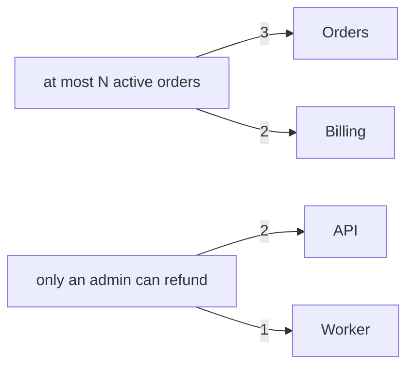

# Business rules heatmap

Same snapshot habit as `heatmap`. Different question: which rules does this app enforce over and over?

A business rule decides an outcome: allow or deny, a price, a limit, an entitlement, or the next state. Formatting, logging, and CRUD passthrough are not rules. A rule is common when the same decision is enforced in more than one site. One site is one enforcing function, schema field, or transition check. Callers of a shared policy count as sites.

One folder per run, under `.snapshots/` in the repo being mapped. The folder name is the local time of the run:

```
NOV-19-5.16PM
```

Month is three uppercase English letters, day and hour have no leading zero, minutes are two digits, `AM`/`PM` is uppercase with no space.

The snapshot freezes the rules as they are at that time. The next run reads the previous business-rules snapshot and edits it. It does not rescan the whole repo from scratch. Do not use a communication `heatmap` snapshot as the base. Those folders have `flow.md` and no `rules.md`.

## Output

```
.snapshots/
└── NOV-19-5.16PM/
    ├── rules.md       the ranked rules, the pattern that found each, and the graph
    └── insights.md    what the git diff changed in those rules
```

Write both files in the repo the user has open. Do not commit unless they ask. If `.snapshots/` is gitignored, still write there and say so in `insights.md`.

## Name the folder

```bash
LC_ALL=C printf '%s-%s-%s.%s%s\n' \
  "$(date +%b | tr '[:lower:]' '[:upper:]')" \
  "$(date +%-d)" \
  "$(date +%-I)" \
  "$(date +%M)" \
  "$(date +%p)"
```

If that directory already exists, append `-2`, then `-3`. Never overwrite a snapshot, and never add `rules.md` into a folder that already holds a communication heatmap.

## Pick the base

Look in `.snapshots/` for directories whose `rules.md` has `kind: business-rules`. The base is the one whose `captured-at` is latest. Folder names omit the year and wrap every twelve hours, so do not sort them as text. If a snapshot has no `captured-at`, use its directory mtime.

No such file means this run is the baseline. Say that in `insights.md` and build the ranking from the code.

## Diff before ranking

Record `git rev-parse HEAD` and whether the worktree is dirty (`git status --porcelain`).

When a base exists, read its `rules.md` completely, then:

```bash
git diff --name-status <base-sha> HEAD
git diff --stat <base-sha> HEAD
git diff --name-status HEAD
```

The third command is the uncommitted work. Ignore paths under `.snapshots/`. Group the rest by module.

If the base SHA is missing or not in this history, keep the previous `rules.md` as the base anyway and diff with `git log --since=<captured-at> --name-status`. Say in `insights.md` that the SHA could not be used.

If no product file differs from the base, committed or not, stop. Tell the user the latest business-rules heatmap still describes this tree. Do not write a duplicate snapshot.

On a real diff, re-hunt patterns only in the modules the diff touched. Recompute those counts. Carry every untouched rule and its sites forward unchanged. Drop sites whose file was deleted.

## Patterns

Hunt in this order. Tune the words to this product. Read the hits. A word that only labels a column is not a rule.

1. **Shared policies.** Functions and types named like a decision: `can`, `isEligible`, `allow`, `deny`, `assert`, `ensure`, `validate`, `within`, `exceeds`, `Policy`, `Rule`, `Guard`. Count callers outside the definition.
2. **Copied comparisons.** The same field against the same threshold in more than one file: status, amount, days, role, quota, tier. Collapse copies into one rule.
3. **Schema constraints.** `min`, `max`, `required`, `enum`, `pattern`, `oneOf` in validators. The same constraint on the same concept in the API, the UI, and a worker is one rule with several sites.
4. **Status transitions.** A switch or table of allowed next states. The table is one rule. Each check that rejects an edge is a site.
5. **Repeated domain gates.** Conditions on eligibility, discount, quota, limit, refund, expiry, approval, tier, penalty, consent, permission. Only when the branch allows, denies, prices, or changes state.

Skip generated code, migrations that only store a column, and tests. Tests confirm a site. They are not an extra site.

Two copies that share a name but disagree on the threshold are one pattern and two rules. Call that out. Drift is the finding.

## What gets drawn

Rank by site count, highest first. A common rule has 2 or more sites. Keep the graph under 15 rule nodes: the ones that cover the repeated patterns. Rules with a single site stay off the graph. Count them in one line. If nothing repeats, say so and list the five strongest single-site rules, each marked `single-site`, so the baseline is not empty.

Nodes are rules and the modules that enforce them. A function is not a node. Edge labels are the site count in that module.

Mark each rule `traced` or `inferred`. Traced means the enforcing code was read. Inferred means the name suggested it.



Under the diagram, one block per drawn rule: the rule in one plain sentence, the pattern that found it, the site count, and up to three `file:line` exemplars plus "and N more".

## rules.md

```markdown
---
kind: business-rules
captured-at: 2026-11-19T17:16:00-06:00
git-sha: <full sha>
dirty: false
base: .snapshots/NOV-19-4.02PM
---

# Business rules

<one sentence: the decisions this app repeats>

## Graph

<mermaid>

Rules traced: ...
Rules inferred: ...
Single-site rules, not drawn: 23
Not in this snapshot: ...

## Most common

### 1. <plain-language rule> — <N> sites

Pattern: shared policy | copied comparison | schema | status transition | domain gate
Status: traced | inferred
Exemplars: `path/file.go:40`, `path/other.go:18`, and 3 more

<one sentence, what outcome it decides>
```

`base` is omitted on the first snapshot. `captured-at` is ISO-8601 with the local offset. `git-sha` is the full HEAD. `dirty: true` means uncommitted work is part of the picture.

## insights.md

This file is about the update, not a second copy of the ranking.

```markdown
# Insights

Base: `.snapshots/NOV-19-4.02PM` @ `<short sha>`
This snapshot: `NOV-19-5.16PM` @ `<short sha>`
Diff: `git diff <base-sha> HEAD` plus uncommitted changes

## Modules and files

- `services/orders` — `policy.go`, `refund.go` (modified)

## Rule updates

- New common rule: only an admin can refund — 3 sites
- Count changed: at most N active orders — 4 → 5
- Dropped below common: ...
- Drift: the quota threshold is 5 in orders and 10 in billing
- Carried forward unchanged: ...
```

First snapshot, the whole file is:

```markdown
# Insights

No previous business-rules heatmap. This snapshot is the baseline.
HEAD: `<full sha>`
Dirty: false
Common rules: <N>
Single-site rules left off the graph: <N>
```

Every line in the update sections has to come from the diff or from a file the diff touched. A module with no rule change is listed under modules and then omitted from rule updates.

## Tell the user

Reply with the new folder path, whether it was a baseline or an update, the modules the diff touched, and the top of the ranking. The files are the record. The reply is the checkup.

For how the app communicates, run `heatmap`. This skill does not draw that graph.
