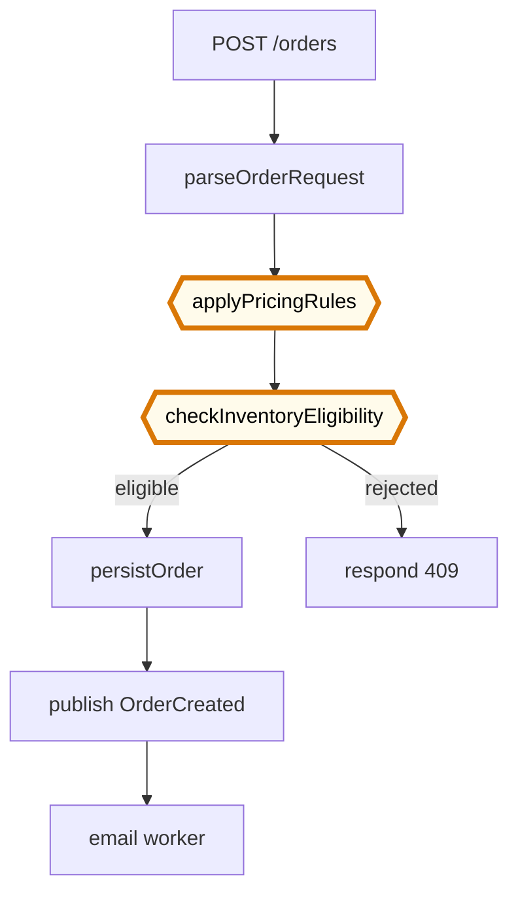

# Heatmap

A repository's folder tree tells you how it was organized. It does not tell you **where the money is** — the code that would be different at a competitor, the rules people actually pay for.

This skill produces that, as dated artifacts in `snapshots/`: the structure annotated by role, the flow as a diagram, and the business logic visually marked.

**Why dated snapshots instead of a doc:** two snapshots diff. A doc rots silently; a snapshot from three months ago compared against today is an architecture drift report nobody had to write.

---

## Output

```
snapshots/
└── 2026-11-18-orders-service/
    ├── README.md            how to read this, what was inferred, what was not traced
    ├── structure.md         the tree, annotated by role, with the churn table
    ├── flow.md              the diagrams, business logic marked
    └── business-logic.md    the ranked list, each with file:line and the rule it implements
```

One directory per run, named `<date>-<scope>`. Commit them: the value is in the diff, and a gitignored snapshot cannot be compared. They are documentation, not build output.

---

## 1. Establish scope and the product question

Scope first: the whole repo, one service, or one flow. A whole-monorepo heatmap in one diagram is unreadable, so for a monorepo do one snapshot per deployable.

Then the question that makes the rest possible: **what does this product actually sell, and what rule decides what a customer gets?** Read the README, the pricing page, the main entity names. You cannot find business logic without knowing what the business is, and this one question saves an hour of guessing.

## 2. Map the structure by role, not by folder

Walk the tree and label each directory with what it *is*, not what it is called:

| Role | What lands here |
|---|---|
| **entry** | HTTP handlers, route files, CLI commands, queue consumers, cron entries, page components |
| **domain** | The rules. Pricing, eligibility, scoring, state transitions, permissions, money math |
| **data** | Models, repositories, queries, migrations, schema |
| **integration** | Clients for other services, SDK wrappers, webhook receivers |
| **plumbing** | DI wiring, config, logging, serialization, middleware, error mappers |
| **generated** | Generated clients, protobuf output, build artifacts, anything with a do-not-edit banner |
| **test** | Fixtures, factories, harnesses |

Write that into `structure.md` as the tree with a role tag and a one-line purpose per directory. **A directory you cannot label is a finding** and goes in the open questions: it is usually either dead or the most important thing in the repo.

Add the churn table, which is evidence rather than opinion:

```bash
git log --format= --name-only --since='12 months ago' \
  | grep -v '^$' | sort | uniq -c | sort -rn | head -30
```

The files that change most often are where the business actually lives, or where the design is wrong. Both are worth the reader's attention, and the distinction is usually obvious once you open them.

## 3. Find the business logic

**The test: would this code be different at a competitor who sells the same thing?** If yes it is business logic. If a different company could use the file unchanged, it is plumbing.

Business logic looks like: pricing and discounts, eligibility and entitlement, tax and fees, state machines over a domain entity, permission rules, scoring and ranking, quota and limit enforcement, retry and refund policy, SLA calculations, anything with money or dates in it.

Plumbing looks like: CRUD passthrough, framework glue, serialization, retry mechanics with no policy, logging, config loading, generated code.

Four heuristics that locate it fast, in order of yield:

```bash
# 1. Domain vocabulary. Tune the words to this product.
grep -rilE 'eligib|discount|pricing|price|tax|invoice|refund|quota|limit|approve|score|tier|commission|penalt|expir' --include='*.ts' --include='*.py' src/

# 2. Branch density with no framework import. High branching plus no framework
#    is almost always a rule, not a wrapper.
grep -cE '\b(if|switch|case|elif)\b' <file>

# 3. Money, percent and date literals.
grep -rnE '[0-9]+\.[0-9]{2}|0\.[0-9]+ *\*|days?|months?|cents' --include='*.ts' src/

# 4. The most-tested files. People write the most tests around the rules
#    they are afraid of breaking.
```

Then **read the candidates**, because every heuristic has false positives. A file that greps for "price" and only formats a currency string is plumbing.

Rank the confirmed list by what breaks if it is wrong: money and entitlement first, then correctness of output, then convenience. For each, record `file:line`, the rule in one plain sentence, and what breaks if it is wrong. That sentence is the deliverable, not the file path.

## 4. Draw the flow

One diagram per flow, **not one diagram for the repo**. Pick the two or three flows that matter: the main request path, the main write path, the background job.

Rules: 20 nodes maximum, the entry point at the top, labels in the reader's words, and business logic marked so it is impossible to miss. For three or more moving parts, build it up across two or three diagrams rather than one dense one.

Marking in Mermaid: a hexagon node plus a thick colored stroke, with a legend. That is the readable equivalent of circling it on a whiteboard.



> **Legend.** Thick amber hexagons are business logic: the rules that would differ at a competitor. Everything else is transport, persistence, or glue.

Under each diagram, one line per marked node: the rule it implements and its `file:line`.

## 5. Be honest in the README

The snapshot is only useful if the reader knows what to trust:

- **Read against inferred.** Which paths you traced through the code and which you deduced from names. A deduced edge is a guess with a nice arrow on it.
- **Not traced.** The flows you skipped and why. "The admin surface and the data export are not in this snapshot."
- **Open questions.** Directories you could not label, business logic you suspect but could not locate, the file with 400 commits and no tests.
- **The commit.** The SHA this snapshot describes, so the next reader knows how stale it is.

## 6. Re-run and diff

Re-run on a cadence or before a refactor, then compare:

```bash
diff -ru snapshots/2026-08-02-orders-service snapshots/2026-11-18-orders-service
```

What the diff tells you, and this is the real payoff: business logic that leaked into a handler, a new integration nobody mentioned, a domain directory that grew a framework import, a rule that moved into generated code. Those are the findings that never show up in a PR review because each individual step looked fine.

## Related

- [`how`](../how/SKILL.md) answers a question about one subsystem in conversation. This produces durable artifacts for a whole repo.
- [`why`](../why/SKILL.md) for why a structure is shaped that way, which the code cannot tell you.
- [`blast-radius`](../../Verification/blast-radius/SKILL.md) once you know where the business logic is and want to change it.
- [`principle-model-the-domain`](../../Principles/principle-model-the-domain/SKILL.md) is usually what a messy heatmap is pointing at: rules scattered across handlers instead of living in one structure.
