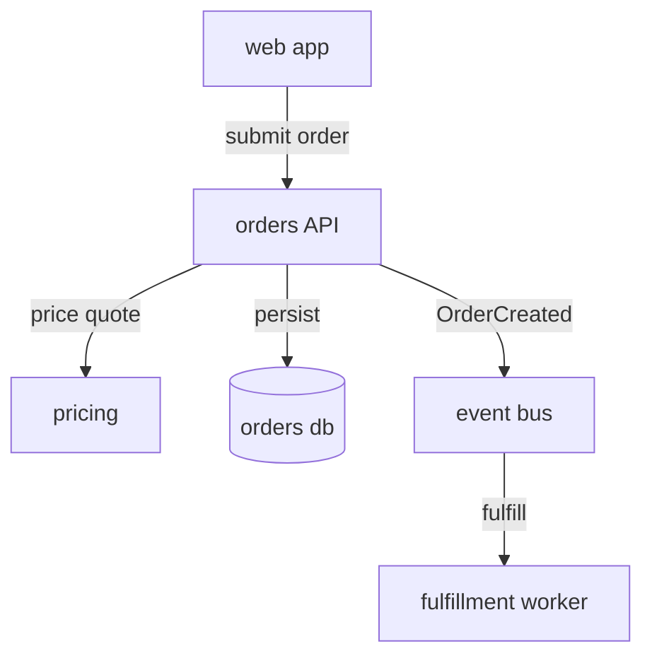

# Heatmap

Snapshot how this repo communicates. One folder per run, under `.snapshots/` in the repo being mapped. The folder name is the local time of the run:

```
NOV-19-5.16PM
```

Month is three uppercase English letters, day and hour have no leading zero, minutes are two digits, `AM`/`PM` is uppercase with no space.

The snapshot freezes the logic as it is at that time. The next run reads the previous snapshot and edits it. It does not redraw the repo from scratch.

## Output

```
.snapshots/
└── NOV-19-5.16PM/
    ├── flow.md        the interaction graph and the logic it freezes, plus trade-offs
    └── insights.md    what the git diff changed in that flow
```

Write both files in the repo the user has open. Do not commit unless they ask. If `.snapshots/` is gitignored, still write there and say so in `insights.md`: another clone will not have this base.

## Name the folder

```bash
LC_ALL=C printf '%s-%s-%s.%s%s\n' \
  "$(date +%b | tr '[:lower:]' '[:upper:]')" \
  "$(date +%-d)" \
  "$(date +%-I)" \
  "$(date +%M)" \
  "$(date +%p)"
```

If that directory already exists, append `-2`, then `-3`. Never overwrite a snapshot.

## Pick the base

Look in `.snapshots/` for directories that contain `flow.md`. The base is the one whose `captured-at` is latest. Folder names omit the year and wrap every twelve hours, so do not sort them as text. If a snapshot has no `captured-at`, use its directory mtime.

No `flow.md` anywhere means this run is the baseline. Say that in `insights.md` and build the graph from the code.

## Diff before drawing

Record `git rev-parse HEAD` and whether the worktree is dirty (`git status --porcelain`).

When a base exists, read its `flow.md` completely, then:

```bash
git diff --name-status <base-sha> HEAD
git diff --stat <base-sha> HEAD
git diff --name-status HEAD
```

The third command is the uncommitted work. Ignore paths under `.snapshots/`. Group the rest by module: the app, package, or top-level directory that owns the file.

If the base SHA is missing or not in this history, keep the previous `flow.md` as the base anyway and diff with `git log --since=<captured-at> --name-status`. Say in `insights.md` that the SHA could not be used.

If no product file differs from the base, committed or not, stop. Tell the user the latest heatmap still describes this tree. Do not write a duplicate snapshot.

On a real diff, read the changed files and the hunks that add, remove, or rewire a call, event, query, or job. Carry every untouched node, edge, and trade-off forward unchanged.

## What the graph is

One high-level graph of communication through the app. Nodes are modules, apps, stores, queues, and external systems. Edges are calls, events, reads, and writes, labeled with what crosses. A function is not a node.

Keep it under 25 nodes. A monorepo gets one diagram of how the deployables talk to each other, then one diagram per deployable only when the overview cannot say what crosses the boundary.

Mark each edge `traced` or `inferred`. Traced means the code was read. Inferred means the name suggested it.

Under the diagram, the current logic in a few paragraphs: the path a real action takes, who owns the state, and where a message stops being a request and becomes a record. Cite `file:line` for each claim.

Then the trade-offs, one per boundary that matters. Name the choice, what it costs, and what it buys. Only trade-offs visible in this repo. On an update, rewrite a trade-off only when the diff touched that boundary.



## flow.md

```markdown
---
captured-at: 2026-11-19T17:16:00-06:00
git-sha: <full sha>
dirty: false
base: .snapshots/NOV-19-4.02PM
---

# Flow

<one sentence: what this repo communicates in order to do>

## Graph

<mermaid>

Edges traced: ...
Edges inferred: ...
Not in this snapshot: ...

## Current logic

<the frozen path, with file:line>

## Trade-offs

- **<boundary>.** <choice>. Costs <cost>. Buys <gain>.
```

`base` is omitted on the first snapshot. `captured-at` is ISO-8601 with the local offset. `git-sha` is the full HEAD. `dirty: true` means uncommitted work is part of the picture.

## insights.md

This file is about the update, not a second copy of the graph.

```markdown
# Insights

Base: `.snapshots/NOV-19-4.02PM` @ `<short sha>`
This snapshot: `NOV-19-5.16PM` @ `<short sha>`
Diff: `git diff <base-sha> HEAD` plus uncommitted changes

## Modules and files

- `services/orders` — `handler.go`, `pricing_client.go` (modified)

## Flow updates

- Added: orders API → pricing, quote request
- Removed: ...
- Relabeled: ...
- Carried forward unchanged: web app, orders db, event bus, fulfillment worker

## Trade-off shifts

- **orders API → pricing.** The quote is now a remote call. A pricing outage rejects checkout instead of using a stale local table.
```

First snapshot, the whole file is:

```markdown
# Insights

No previous heatmap. This snapshot is the baseline.
HEAD: `<full sha>`
Dirty: false
```

Every line in the update sections has to come from the diff or from a file the diff touched. A module with no communication change is listed under modules and then omitted from flow updates.

## Tell the user

Reply with the new folder path, whether it was a baseline or an update, the modules the diff touched, and the graph. The files are the record. The reply is the checkup.

For the rules the app enforces over and over, run `business-rules-heatmap`. This skill does not rank those.
